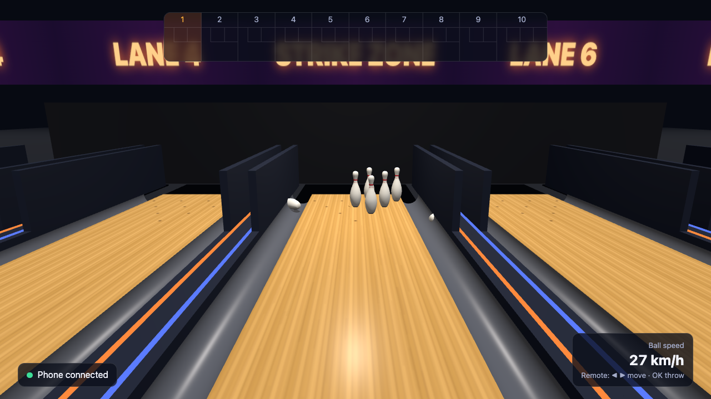

# Motion Games

Camera-based motion games for the living room. A phone tracks your body, and the game plays on the TV.
No controller or extra hardware is needed. The first game is **🎳 Motion Bowling**.

| Folder | What it is |
|---|---|
| [`bowling/`](bowling/) | Motion Bowling: 3D game (three.js), body tracking (MediaPipe), Node dev server, Android app |
| [`docs/ROADMAP.md`](docs/ROADMAP.md) | Plan to get to the Play Store with a subscription model |
| [`THIRD_PARTY_NOTICES.md`](THIRD_PARTY_NOTICES.md) | Open-source licences used |



See the [step-by-step guide with screenshots](bowling/README.md#how-to-play-step-by-step).

## Quick start (development)
```bash
cd bowling
npm install
node server.js
```
Then open `http://localhost:3000/tv` (game) and `http://localhost:3000/camera` (body tracking) in a browser.

## Build the Android app
```bash
bash bowling/android/build.sh
```
This writes `bowling/bowling.apk`. See [bowling/README.md](bowling/README.md) for playing on a phone and TV.
