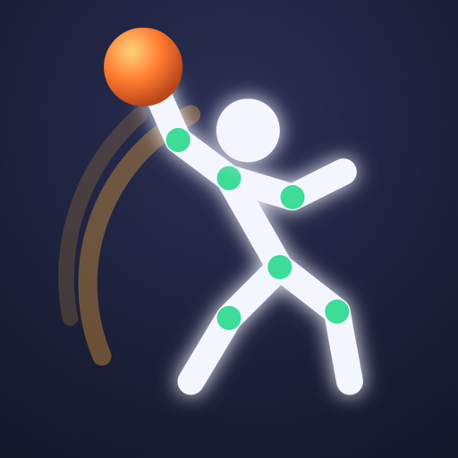

# 🎮 Motion Games

Living-room games you play with your body. An Android phone tracks your movements, and the game plays on your TV.
You don't need a games console, a controller or a computer. All you need is a phone, a TV with a web browser, and Wi-Fi.

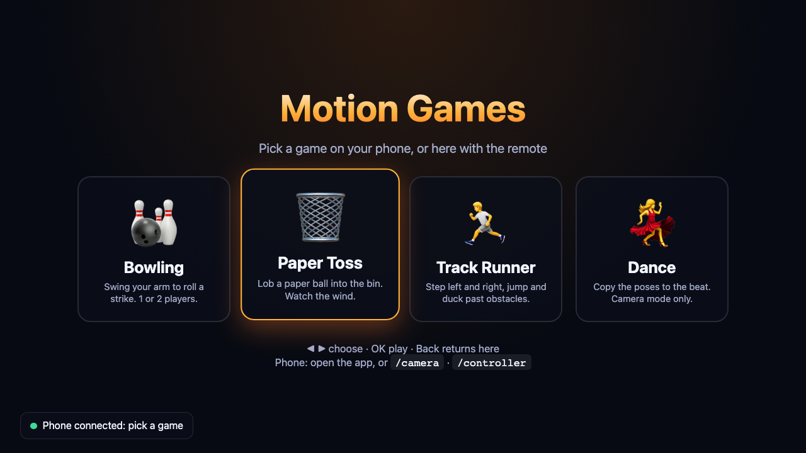

| | Game | How you play |
|---|---|---|
| 🎳 | **Bowling** | Swing your arm to roll the ball. Lean to add hook. 1 or 2 players. |
| 🗑️ | **Paper Toss** | Lob a paper ball into the bin. The bin moves back after each basket, and the wind gets stronger. |
| 🏃 | **Track Runner** | Endless three-lane run. Step left and right, hop to jump, crouch to duck. |
| 💃 | **Dance** | Copy the poses on the beat. The game compares 8 limb directions with the target pose. |

---

## Contents
- [What you need](#what-you-need)
- [Install the app](#install-the-app)
- [Set up: phone + TV](#set-up-phone--tv)
- [How to play each game](#how-to-play-each-game)
- [Troubleshooting](#troubleshooting)
- [For developers](#for-developers)

## What you need
- **An Android phone** (Android 7 or newer) with a camera. The app runs a small game server on the phone, and the phone also does the body tracking.
- **A TV with a web browser**, for example an Android TV with *TV Bro* or *Chrome*. A laptop or tablet browser works too.
- **Phone and TV on the same Wi-Fi network.** Internet access is not needed. The games work entirely on your home network.
- For **Camera mode**: something to stand the phone on, below or in front of the TV, and 2–3 m of space.

## Install the app

### Option A: download the APK
1. On your Android phone, open the [**Releases page**](https://github.com/abhay-arch-dev/3d-games/releases/latest) and download `MotionGames.apk`.
2. Open the downloaded file. Android asks for permission to *install unknown apps* for your browser or file manager: allow it.
3. Tap **Install**. If Play Protect warns that the app is unrecognised, tap **More details → Install anyway**. This happens because the app doesn't come from the Play Store.

### Option B: build it yourself
See [bowling-rn/README.md](bowling-rn/README.md#build-and-install-on-your-phone). It's one command once the Android SDK is set up.

## Set up: phone + TV

**1. Open the app on the phone and pick a game.** The screen also shows the address to open on the TV.

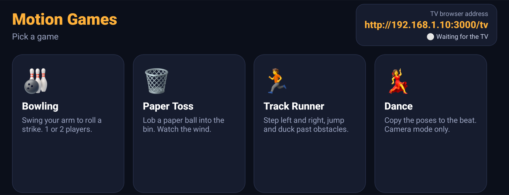

**2. Open the address on the TV.** In the TV's browser, type the address from the app, for example `http://192.168.1.10:3000/tv`, and press OK.
Tip: bookmark it. The address stays the same while the phone stays on the same Wi-Fi.

**3. Choose how to play.**

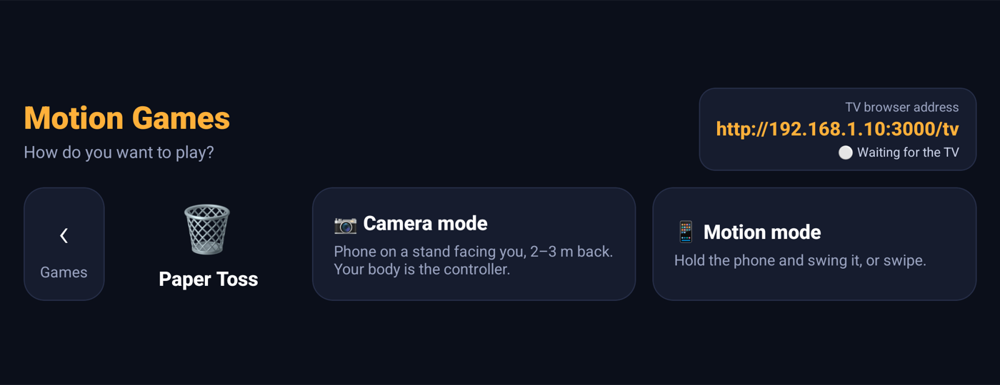

- **📷 Camera mode:** stand the phone up facing you, below the TV, and step back 2–3 m so your whole body is in view. Your body is the controller. Tracking runs on the phone only, and no video leaves it.
- **📱 Motion mode:** hold the phone in your hand and swing it or swipe on it. This works for Bowling, Paper Toss and Track Runner.

The TV switches to the game you picked by itself. You can also pick games on the TV with the remote: **◀ ▶** to choose, **OK** to play, **Back** to return to the game list.

## How to play each game

### 🎳 Bowling
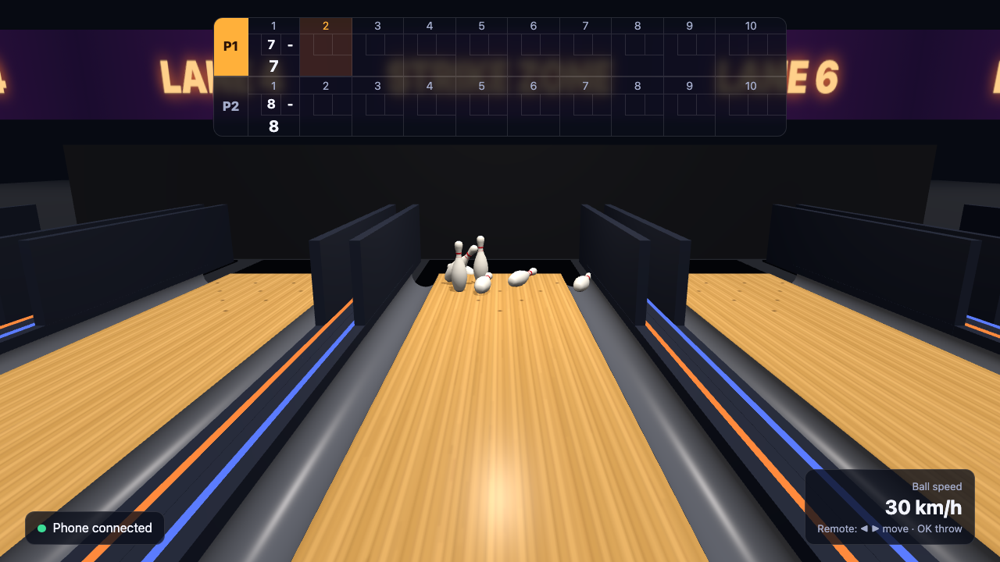

| | Camera mode | Motion mode | TV remote |
|---|---|---|---|
| Aim | Step left or right | Tilt the phone, or use the slider | ◀ ▶ |
| Throw | Lower your arm, then swing it up fast | Hold the ball button, swing, let go. Or swipe up | OK |
| Hook | Lean your shoulders | Twist your wrist as you let go, or curve the swipe | – |
| New game | Raise both hands | **New game** button | OK when the game is over |

**2 players:** pick **2 Players** on the TV start screen (or press ◀ ▶ there), or tap **2P** on the phone. Players take turns, one frame each, as in real bowling. The scoreboard shows both players and highlights whose turn it is. Play with one phone passed between you, or connect a phone each.

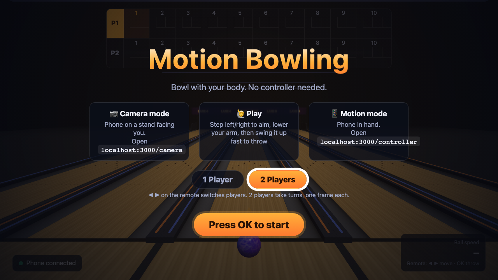 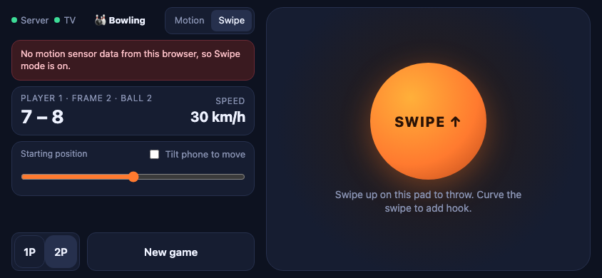

### 🗑️ Paper Toss
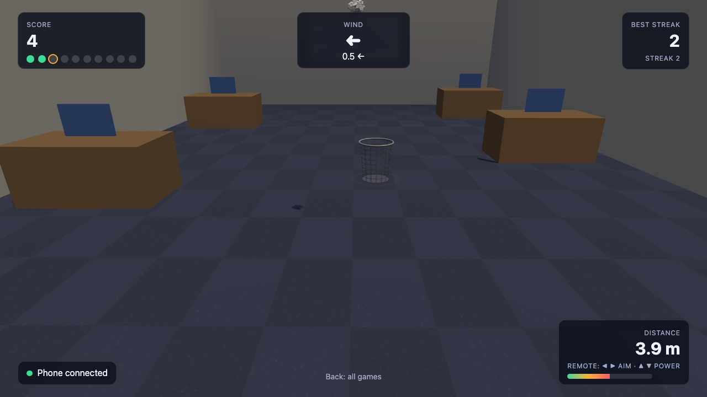

- You get **10 shots**. A clean basket scores **2**, one off the rim scores **1**.
- Each basket moves the bin further back, and the **wind** (the arrow at the top, plus the fan in the room) pushes the ball sideways. Aim against the wind.
- **Camera:** step left or right to aim, then swing your arm up. A faster swing throws further.
- **Phone:** swing it or swipe up. About half power is the right length for the bin.
- **Remote:** ◀ ▶ to aim, ▲ ▼ to set power, OK to throw.

### 🏃 Track Runner
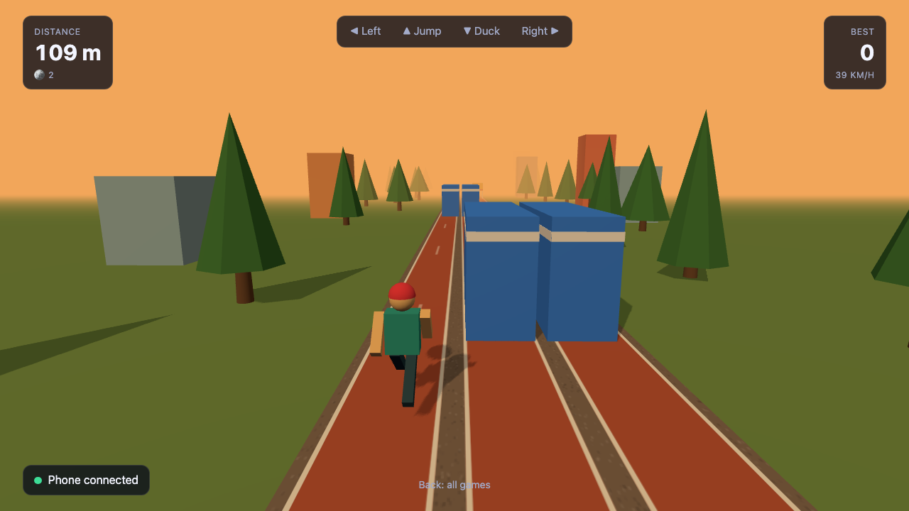

- Run as far as you can and collect coins. Score = metres + 10 per coin. The game speeds up as you go.
- **Red-and-white hurdles:** jump. **Yellow signs:** duck under. **Blue blocks:** change lane.
- **Camera:** stand in the middle of the view. **Step** left or right to change lane, **hop** to jump, **crouch** to duck. The small figure in the corner shows the lane borders. Raise both hands to restart.
- **Phone:** swipe ◀ ▶ ▲ ▼ on the pad.
- **Remote:** arrow keys. OK starts the game.

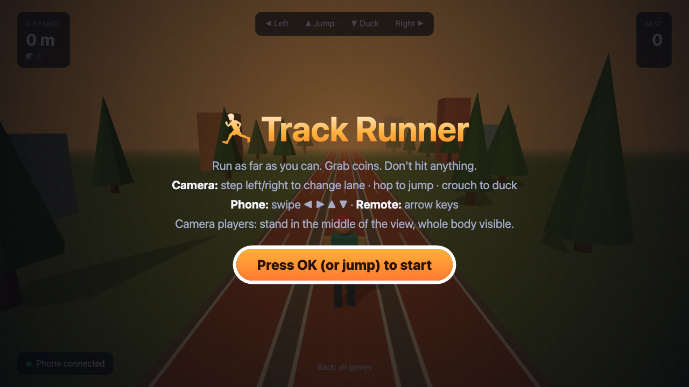 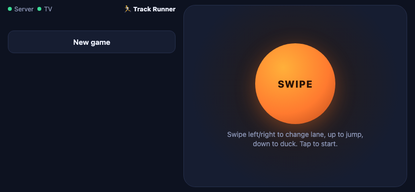

### 💃 Dance (Camera mode only)
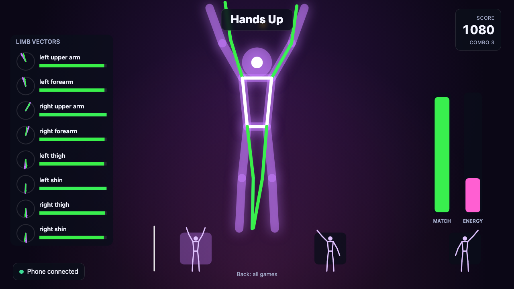

- **Raise both hands** (or press OK) to start the song.
- The glowing purple figure is the pose to hit. Your own skeleton is drawn on top of it, and each limb turns green as it lines up.
- The cards along the bottom move toward the white line. Hold the pose as each card reaches the line, on the 4th beat.
- **Limb vectors** (left panel): for each upper arm, forearm, thigh and shin, the purple arrow is the target direction and the coloured arrow is yours.
- Each move is rated **PERFECT / GREAT / GOOD / MISS**. Ratings in a row build a combo bonus. The **Match** meter shows how close you are right now, and the **Energy** meter shows how much you're moving.

## Troubleshooting
| Problem | Fix |
|---|---|
| The TV page doesn't load | Check that the phone and TV are on the **same Wi-Fi** (not a guest network). Use the exact address shown in the app, including `:3000`. |
| The app shows *Connect to Wi-Fi* | Turn on Wi-Fi on the phone. Mobile data alone gives the TV nothing to connect to. |
| Camera mode doesn't see me | Step back until your **whole body**, head to feet, is in view, and turn on more light. |
| Motion mode says *Swipe mode is on* | This browser has no motion sensors. Use the app, or swipe instead. |
| The game is slow on the TV | Add `?quality=low` to the Bowling address, or use a different TV browser. |
| Sound doesn't play | TV browsers only play sound after you press a button. Press OK on the start screen. |

## For developers
| Folder | What it is |
|---|---|
| [`bowling-rn/`](bowling-rn/) | **The app.** React Native (TypeScript) app that runs the server. The games are TypeScript web pages (three.js, MediaPipe) shown on the TV and in the app. [Developer guide →](bowling-rn/README.md) |
| [`bowling/`](bowling/) | The original browser-only Bowling prototype (Node server, run with Termux). Kept for reference. |
| [`docs/ROADMAP.md`](docs/ROADMAP.md) | Plan to get to the Play Store |
| [`THIRD_PARTY_NOTICES.md`](THIRD_PARTY_NOTICES.md) | Open-source licences used |

Quick try in a desktop browser, no phone needed:
```bash
cd bowling-rn && npm install && npm run build:web && npm run serve
# open http://localhost:3000/tv  (the TV), and http://localhost:3000/controller  (the phone)
```
