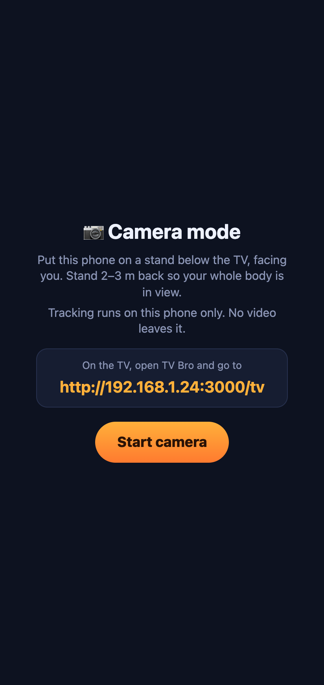
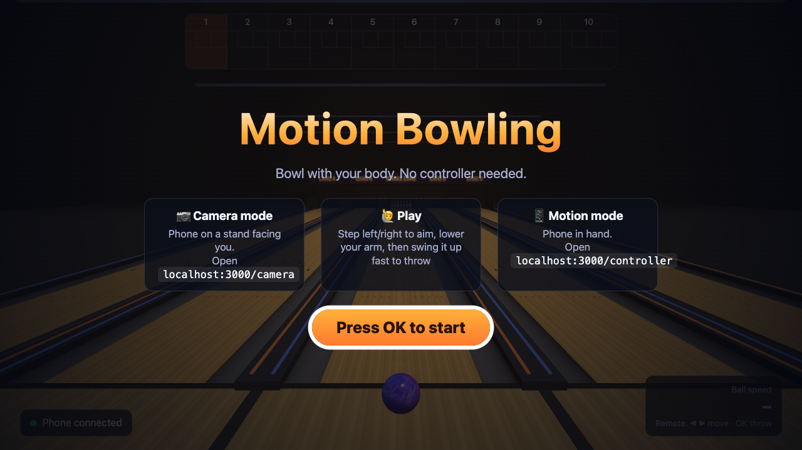
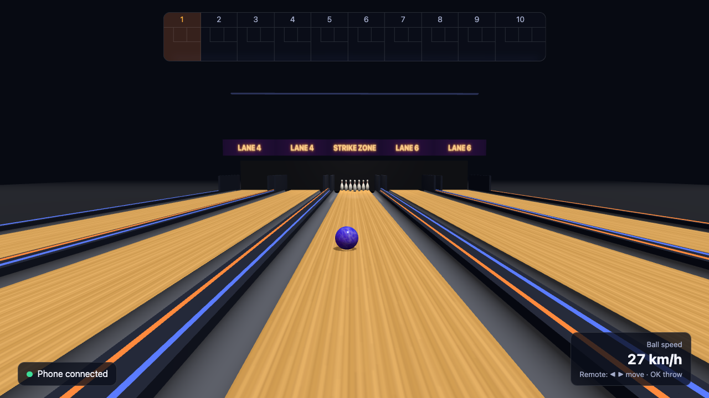
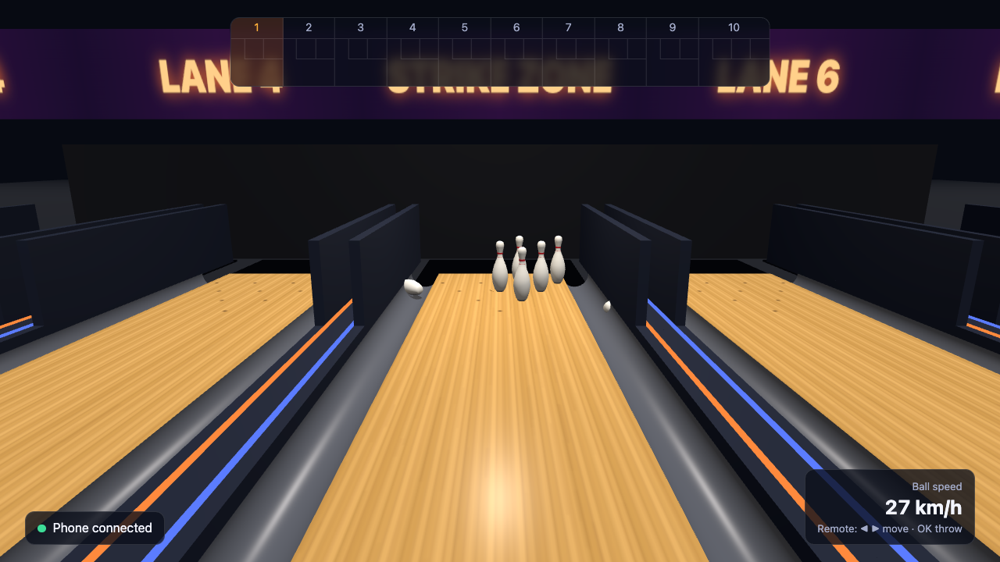
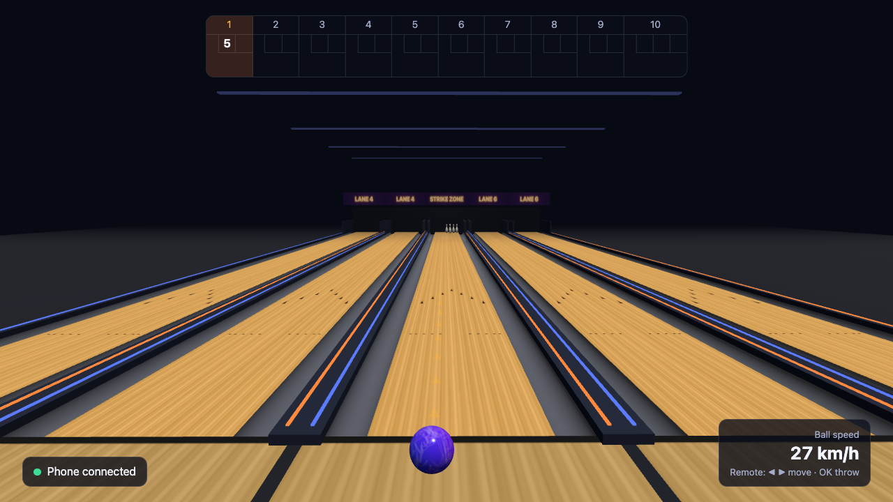
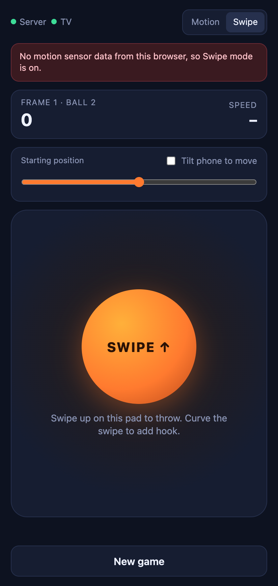

# 🎳 Motion Bowling (original prototype)

> **This is the original browser-only prototype, run with Termux.** The current app, with all four games, 2-player Bowling and an installable APK, is in [`bowling-rn/`](../bowling-rn/). See the [main README](../README.md) for how to install and play.

A 3D bowling game for the **OnePlus Android TV**, played with a **OnePlus 6**. Two ways to play:

- **📷 Camera mode (main):** the phone sits on a stand below the TV and tracks your body, Kinect-style. You bowl with a real arm swing and nothing in your hands.
- **📱 Motion mode:** you hold the phone and swing it like the ball.

The phone runs the server and does the tracking. The TV only shows the game. No computer is needed to play.

```
OnePlus 6 on a stand (Termux: node server.js)          OnePlus Android TV
  Chrome → http://localhost:3000/camera   ⇄ Wi-Fi ⇄    TV Bro → http://<phone-IP>:3000/tv
```

Body tracking (Google MediaPipe Pose) runs entirely on the phone. No video leaves it, and it works without internet.

## One-time setup

### On the phone (OnePlus 6)
1. Install **F-Droid** from https://f-droid.org, then install **Termux** from F-Droid.
   Don't use the Play Store version of Termux. It's outdated and package installs fail.
2. Open Termux and run:
   ```
   pkg update -y && pkg install -y nodejs unzip
   termux-setup-storage
   ```
   Tap **Allow** when it asks for storage access.
3. Copy `bowling.zip` to the phone's **Download** folder over USB, Google Drive, or anything else that works.
   To rebuild the zip on the Mac, run `bash scripts/make-zip.sh`.
4. In Termux:
   ```
   cd ~ && unzip -o ~/storage/downloads/bowling.zip
   ```

### On the TV
1. Open the Play Store on the TV and install **TV Bro**, a free browser for Android TV.
2. Connect the TV to the **same Wi-Fi** as the phone. Use 5 GHz if you have it.

## How to play, step by step

### Step 1: Start the server and open the camera page on the phone
Run `bash ~/bowling/start.sh` in Termux. The camera page opens and shows the address to type on the TV. Tap **Start camera**.



### Step 2: Open the game on the TV and press OK
Go to the address in TV Bro. The title screen shows both ways to play. Press **OK** on the remote to start.



### Step 3: Aim and throw
Step left or right to pick your spot, let your arm hang down until the stick figure turns green, then swing up fast.
The ball speed shows in the bottom-right corner.



### Step 4: Watch the pins fall
The camera follows the ball down to the pins. Lean while you swing to hook it into the pocket.



### Step 5: Check your score and bowl again
The scoreboard at the top updates after every ball. A game is 10 frames with standard strike and spare scoring.
When the game ends, raise both hands above your head for 1.5 s to start a new one.



### No camera stand? Use the phone as a controller
Run `bash ~/bowling/start.sh controller` and hold the phone. In **Motion** mode, swing it like a ball. In **Swipe** mode,
swipe up on the orange pad (curve the swipe for hook). The slider sets your starting spot.



## Every time you play (camera mode)
1. **Phone:** open Termux and run `bash ~/bowling/start.sh`.
   It prints the TV address, for example `http://192.168.1.23:3000/tv`, and opens the camera page in Chrome.
2. **Phone:** tap **Start camera** and allow camera access. Put the phone on a stand below or beside the TV, facing you.
   Use the front camera to see yourself on the phone screen, or the back camera for a wider view.
3. **TV:** open TV Bro and go to that address. Bookmark it so next time is one click.
4. **TV remote:** press **OK** to start. This also turns on sound and full screen.
5. **Stand 2–3 m back** so your whole body is in view. The stick figure in the TV's corner shows what the camera sees.
6. **Bowl:**
   | Do this | Effect |
   |---|---|
   | Step left / right | Move your starting spot on the lane |
   | Let your bowling arm hang down | Get ready (stick figure turns **green**) |
   | Swing it up fast, past your shoulder | Throw. A faster swing throws a faster ball. |
   | Lean left / right while you swing | Hook the ball that way |
   | Both hands above your head for 1.5 s | New game, once the game is over |

   On the phone, choose **Left hand** if you bowl left-handed.

Keep the phone plugged in. Running the camera, tracking and server together uses a lot of battery and warms the phone.
Good, even lighting in front of you helps tracking a lot. Avoid a bright window behind you.

## Motion mode (phone in your hand)
Run `bash ~/bowling/start.sh controller` instead. Tilt left or right to choose your starting spot. Then **hold the orange button,
swing your arm forward like a real bowler, and let go**. A faster swing throws a faster ball, and twisting your wrist at release adds hook.

## Other controls
| Where | Control | Action |
|---|---|---|
| Phone | **Swipe** mode (top right) | Swipe up to throw. Curve the swipe to add hook. Works without motion sensors. |
| Phone | Position slider | Set the starting spot by hand instead of tilting |
| TV remote | ◀ ▶ | Move the starting spot |
| TV remote | OK | Throw a medium straight ball (play without the phone) |
| TV URL | `/tv?quality=low` | Turns off shadows and anti-aliasing if the game stutters |
| TV URL | `/tv?fps` | Shows frames per second in the corner |

## Troubleshooting
- **TV can't open the page:** check both devices are on the same Wi-Fi, and use the IP that `start.sh` printed.
  Some routers block devices from talking to each other ("AP/client isolation"). Turn that off in the router settings.
- **Camera or motion sensors don't work:** open the page as `http://localhost:3000/...` on the phone
  that runs the server. Chrome only allows the camera and motion sensors on `localhost` or HTTPS pages.
- **Throws trigger by accident, or swings are missed:** adjust the `GESTURE` values at the top of `public/gestures.js`.
  `minVel` sets how fast a swing must be, and `lowY`/`highY` set how low the arm must start and how high it must finish.
- **Tracking is slow (fps shown at top right of the camera page):** turn the preview **Off** on the phone to save work.
- **Server stops when the phone screen turns off:** `start.sh` calls `termux-wake-lock`. Also set
  Settings → Battery → Battery optimisation → Termux → **Don't optimise**.

## Tuning
Camera gesture thresholds are at the top of `public/gestures.js` (`GESTURE`). Motion-mode swing sensitivity is at the top of `public/controller.js` (`MOTION`). The lane physics
(ball speed range, hook strength, pin friction) is in `public/game.js`. Both are first guesses that need tuning on the real phone.

## Files
- `server.js`: web server plus WebSocket relay. It needs no npm packages of its own and serves three.js and MediaPipe as static files.
- `public/tv.html`, `public/game.js`: 3D game (three.js r160)
- `public/camera.html`, `public/camera.js`: camera mode (runs body tracking on the phone)
- `public/gestures.js`: turns body positions into aim, throw, hook and new-game actions
- `public/models/pose_landmarker_lite.task`: MediaPipe body-tracking model
- `public/controller.html`, `public/controller.js`: motion-mode controller
- `start.sh`: Termux launcher
- `scripts/make-zip.sh`: packages everything the phone needs into `bowling.zip` (about 13 MB)
